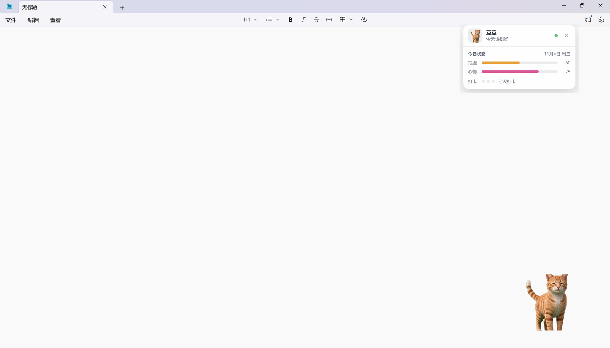
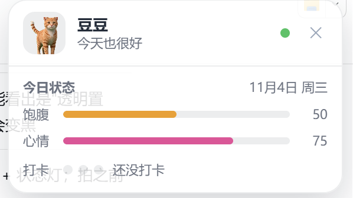
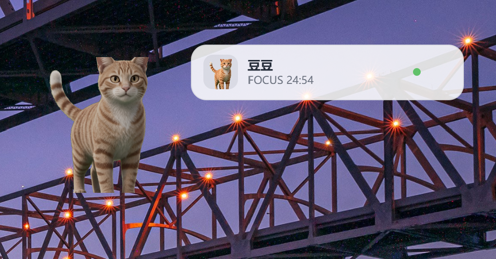
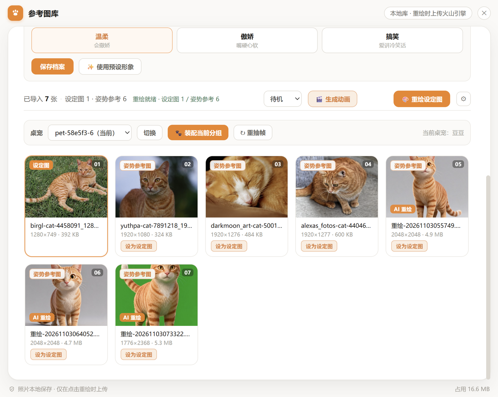
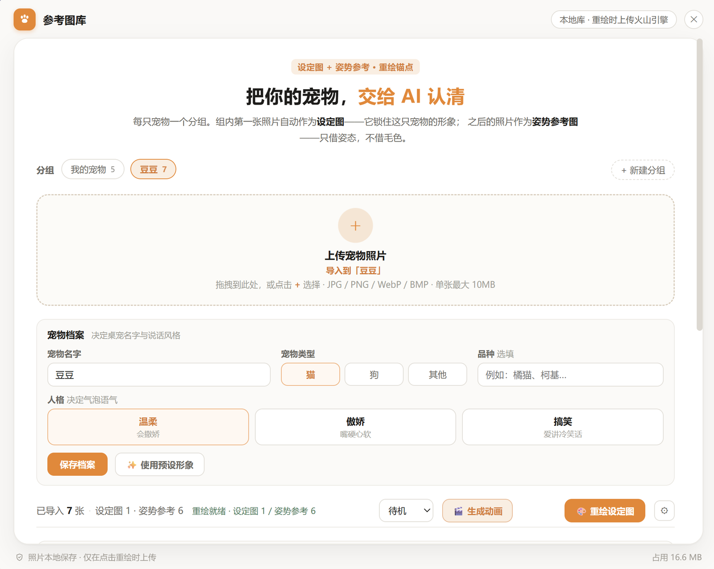
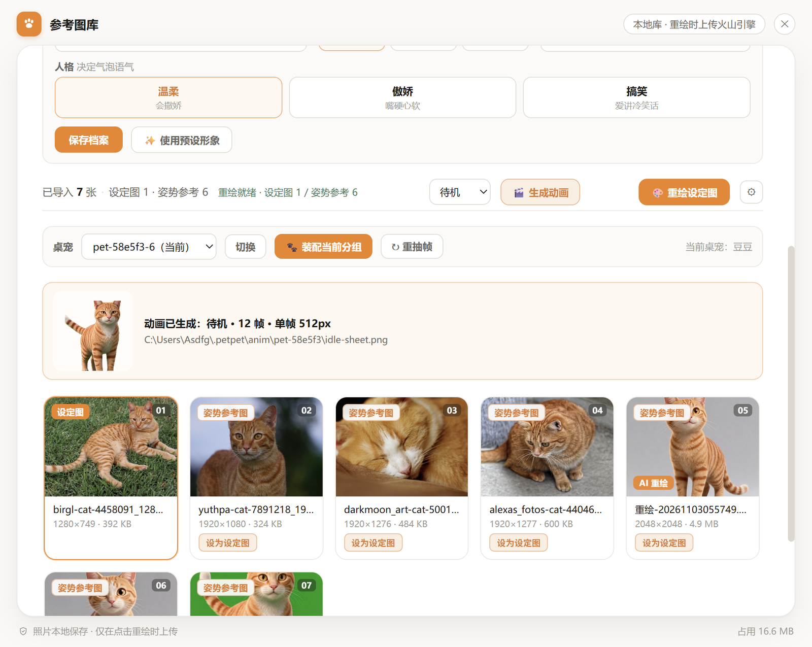
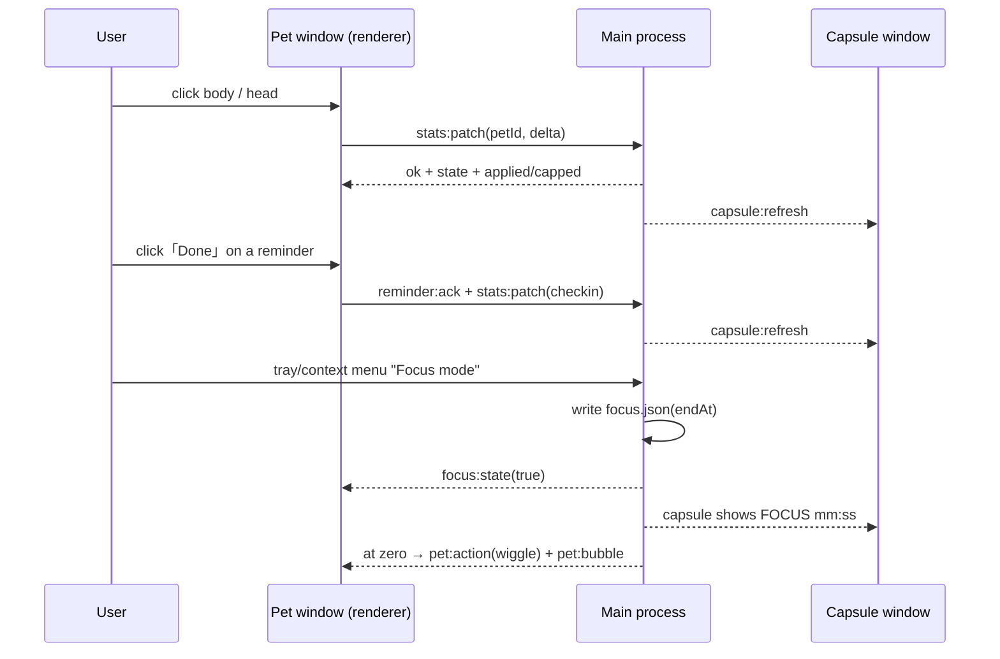

# PawPal · From Real Photos to a Desktop Pet That Keeps You Company

**English** | [中文](README.md)


> **PawPal is not a "desktop pet player" — it's a complete production line** from your real pet's photos to a
> desktop avatar: photo library → AI restyle into a key-art setup image → AI-generated action videos →
> local frame extraction, matting and sprite-sheet packing → one-click assembly into a pet pack → a desktop
> client that runs it. It has its own looks, actions and personality — and it will remind you to drink water
> and sit with you through a focus session.

---

## 📸 Screenshots

| Desktop pet (transparent, always-on-top) | Status capsule (expanded) | Focus mode (FOCUS countdown, pet frozen) |
|:---:|:---:|:---:|
|  |  |  |

| Reference library (groups / thumbnails / assembly) | Pet profile (species & persona) | Animation generation (sprite preview) |
|:---:|:---:|:---:|
|  |  |  |

> Captured on a real Windows machine (DouDou the orange cat). The animation shot is a real preview produced by the local
> "↻ re-extract" path (rebuilds the sheet from the already-downloaded mp4, no cloud credits). Legacy assets remain in `assets/`.


## Set expectations first

- **Semi-automated, not one-click**: AI generation is a dice roll (same prompt, different results) and **owner
  verification is irreplaceable** (AI misidentifies your pet's features). You decide what it looks like and what it does.
- **No ready-made assets**: this repo ships a **production line + a reference client**. Generate your own pet from your own photos.
- **Just want a photo to move?** Use the platform's built-in "bring a photo to life" feature — you don't need this.

---

## What it does today

### Asset production (one-click panel, or CLI)

| Capability | Details |
|---|---|
| Reference library | Multi-pet groups, setup-image vs. pose-reference roles, thumbnail grid, drag & batch import, ≤10MB per image, fail-closed |
| AI restyle | Repaints real photos into a "green-screen-on-four-sides" stylized setup image (Seedream); readiness gate (≥1 setup image and ≥3 pose references) before any request is sent |
| Animation generation | Seedance action video → **local** frame extraction + edge-connected-component matting + horizontal sprite sheet (no ffmpeg/Python needed); `taskId` persisted for traceability, late downloads can still be re-extracted locally |
| Pack assembly | Output → `~/.petpet/pets/<id>/` (`pet.json` v3 + sprite sheets); auto-suffixes on name clash, switches to the new pet when done |
| Contract validation | `pipeline/validate_pet.py` checks fields, texture limits (`frames × cellWidth ≤ 16384px`) and text sanitization |

### Desktop client (`viewer/`, Electron + PixiJS)

| Capability | Details |
|---|---|
| Pets & actions | Switch pets from tray/context menu; 8+ weighted random actions plus `transitions` behavior chains (manual switches are never overridden) |
| Window behavior | Frameless transparent always-on-top, drag to move, wheel to scale (window follows, clamped to the work area), **click-through on transparent pixels** |
| Reminders | Create from panel/tray, persisted locally; on fire: **sound + shake + big bubble**, `[Done]` to check in, queued as "N more" |
| Click zones | **Head** = pat (mood +5); **body** = hint about how to feed (**no stat change**) |
| Persona bubbles | `persona` (gentle / tsundere / funny) × 4 scene pools, falls back to `bubbles` |
| Diary | Behavior events settle into `activity.json`, viewable in its own panel |
| Stats | Satiety / mood / check-ins: daily reset, pat cap 15/day, **feeding happens only via the reminder's `[Done]`**, missed reminder within 1 min = −30 (floored at 0) |
| Expression | Satiety <30 collapses and cries hungry, >80 hops 3 times; mood <30 turns away with a rain cloud, >80 **heart burst for 10 s** |
| Status capsule | Small always-on-top window in the top-right corner: 56px bar collapsed, expands on hover; click-through, never steals focus |
| Focus mode | Tray/context menu opens a settings card (1–180 min) → capsule counts down → pet dims and pauses random behavior → wake-up message at zero |

### Engineering & quality

| Item | Status |
|---|---|
| Unit tests | **299 cases** (296 passing / 3 skipped) covering hit-testing, stats state machine, reminder queue, focus timing, sprite assembly, library storage, import safety |
| CI | `pipeline tests` (3.9 / 3.11 / 3.12 groups), `client build`, `macOS package`, `Windows installer` + a separate Boundary Test workflow |
| Regression scripts | `viewer/scripts/boundary-test.cjs` (interrupt/transition boundaries), `viewer/scripts/memtest.cjs` (100-switch texture plateau) |
| Security | Path-traversal allow-list, zip-slip blocked on both ends, text sanitization (zero-width/BiDi), API keys `0600` main-process only |

---

## The full flow

```mermaid
graph LR
    subgraph Assets
        A["1 Real photos<br/>library groups"] --> B["2 AI restyle<br/>green-screen key art"]
        B --> C["3 Animation<br/>Seedance video"]
        C --> D["4 Local frame extraction"]
        D --> E["5 Matting<br/>edge components"]
        E --> F["6 Sprite sheet<br/>≤16384px"]
        F --> G["7 Assemble pack<br/>pet.json v3 + sheet"]
    end
    G --> H[("~/.petpet/pets/&lt;id&gt;/")]
    H --> I

    subgraph Client
        I["8 Load pack<br/>multi-pet switch"] --> J["9 Play actions<br/>weights + transitions"]
        J --> K["10 Interaction<br/>drag / scale / click-through"]
    end

    K --> L{"User events"}
    L -->|Head click| M["Pat: mood +5<br/>cap 15/day"]
    L -->|Body click| N["Feed hint only<br/>no stat change"]
    L -->|Reminder「Done」| O["Check-in: satiety +20<br/>first of day: mood +10"]
    L -->|Missed reminder| P["Mood/satiety −30<br/>floored at 0"]
    M --> Q["Stats state machine<br/>state/&lt;petId&gt;.json"]
    O --> Q
    P --> Q
    Q --> R["Status capsule<br/>top-right"]
    Q --> S["Expression<br/>collapse / hop / cloud / hearts"]
    R --> T["Focus mode<br/>pomodoro → wake-up"]
```



**Runtime call flow**:



---

## Quick start

### Path A: one-click panel (recommended; needs your own Volcano Engine key)

```bash
cd viewer
npm install
npm start
```

Then: tray/context menu → "🖼 Reference library" → create a group and import photos → "🎨 Restyle" for
green-screen key art → "🎬 Generate animation" for action videos → "📦 Assemble group" → the desktop pet
switches to yours immediately.

> Without keys the app makes **no network calls at all**; manually made assets can be assembled the same way.

### Path B: CLI pipeline (offline, Python)

```bash
pip install -r requirements.txt
python pipeline/select_frames.py --input <frames-dir> --output selected/ --frames 12
python pipeline/remove_bg.py     --input selected/ --output cutout/
python pipeline/clean_cutout.py  --input cutout/   --output clean/
python pipeline/make_sheet.py    --input clean/    --output . --name mypet.png
python pipeline/validate_pet.py  mypet/            # always run before packing
```

### Path C: see it right now (no account)

```bash
# macOS
mkdir -p ~/.petpet/pets && cp -r examples/dev-pet ~/.petpet/pets/dev-pet
# Windows: copy examples\dev-pet to C:\Users\<username>\.petpet\pets\dev-pet
```

`examples/dev-pet` is an **8-action self-test pack** (0.5MB, 256px cells, fully transparent) built to exercise
interaction / stats / reminders / focus — **not production art**.

### Run the tests

```bash
cd viewer && npm test          # vitest, 299 cases
python -m pytest tests/        # pipeline unit tests
python pipeline/check_refs.py  # docs matrix reference integrity
```

---

## Repository layout

```
PawPal/
├── README.md / README.en.md   Chinese / English (this file)
├── docs/                      methodology 00–16 + review & security checklists + handoff contracts
├── pipeline/                  runnable scripts (select / remove-bg / clean / make-sheet / validate / prompt / doc checks)
├── schema/                    machine-readable contracts (pet.json v3 + 16-field profile)
├── templates/                 fill-in templates (pet-profile.example.json)
├── viewer/                    reference client (Electron + PixiJS + asset panel)
│   ├── main.js                main process: windows / tray / menu / reminders / animation jobs / assembly
│   ├── companion.cjs          stats facade (stats / prefs / persona write-back)
│   ├── stats-store.cjs        stats state machine (daily reset / caps / penalties / atomic writes)
│   ├── status-focus.cjs       status capsule window
│   ├── focus.cjs / focus-time.cjs
│   ├── capsule.* / focus.*    capsule & focus-card UI
│   ├── refs.* / pet-assembler.cjs / animator*   library / assembly / animation (frozen this round)
│   ├── scripts/               boundary-test / memtest / e2e scripts
│   └── src/                   pet renderer (PIXI + hit-testing + expression layer)
├── examples/                  sample packs (dev-pet self-test / redshao full loop / baobao second breed / demo pack)
├── tests/                     pipeline pytest
├── assets/                    legacy showcase assets (demo-preview.jpg / demo.gif)
└── SECURITY.md / CONTRIBUTING.md / LICENSE
```

---

## Data contract (`pet.json` v3)

12 top-level fields: `version / id / name / style / theme / cellWidth / cellHeight / bubbles / identity / temperament / persona / actions`

| Field | Purpose |
|---|---|
| `persona` | Personality: `温柔` / `傲娇` / `搞笑` — selects the bubble pool (falls back to `bubbles`) |
| `identity` / `temperament` | V2-A: identity facts + temperament sliders (0–1 object) that modulate random behavior weights |
| `actions` | Per action: `file/sprite`, `frames`, `fps`, `weight`, `label`, `diary`, `transitions`, `scale`, `loop`, `pingpong` |
| Texture red line | **`frames × cellWidth ≤ 16384px`** — exceed it and the whole window goes black |

Full contract: [docs/08-接口协议.md](docs/08-接口协议.md) (Chinese). Capability status: [docs/14-实现状态矩阵.md](docs/14-实现状态矩阵.md).

> 📖 **Docs are written in Chinese.** The methodology is language-agnostic — scripts, JSON schemas and viewer
> code are universal, and machine translation works well. `docs/01` (data model), `docs/05` (pipeline) and
> `docs/08` (contract) are the most useful starting points. English translations are welcome via PR.

---

## Documentation map

| Goal | Read |
|---|---|
| Make a pet from your own photos | [01-数据模型](docs/01-数据模型.md) → [02-特征与提示词](docs/02-特征与提示词.md) → [05-素材管线](docs/05-素材管线.md) |
| Understand the design & trade-offs | [00-设计缘起](docs/00-设计缘起.md) → [04-架构设计](docs/04-架构设计.md) → [10-架构升级评估](docs/10-架构升级评估.md) |
| Check implementation status | **[14-实现状态矩阵](docs/14-实现状态矩阵.md)** (single source of truth) → [13-验证台账](docs/13-验证台账-20260810.md) |
| Avoid the traps | [07-踩坑实录](docs/07-踩坑实录.md) (11 real incidents with hard rules) |
| Animation pipeline details | [16-桌宠动画链路](docs/16-桌宠动画链路-20261103.md) |
| Shared contracts | [docs/handoff/README.md](docs/handoff/README.md) (C1–C5 contracts, dependency matrix) |

---

## Core ideas

1. **A pet is a data pack**: switch pets by switching directories, never touch code
2. **Prompts are a translation of traits**: structured traits → controllable generation
3. **Every tool is replaceable**: Seedance / rembg / PIL are not the only options
4. **Mischief has boundaries**: visual mischief yes, real file operations no
5. **Honest status labels**: never claim support for something untested

---

## Roadmap

**✅ Done**: asset production line (library / restyle / animation / assembly / validation) · desktop client
(multi-pet, transition chains, reminders, diary, persona bubbles, hit-testing) · stats & expression ·
status capsule + focus mode · CI/Release automation · 299 unit tests

**🔨 In progress**: Windows hands-on validation loop · gesture/interaction refinements · docs & screenshots

**🔭 Planned**: memory & relationship system (events → habits) · showcase & sharing · theme packs

---

## Contributing

- New pet packs: submit them per the [docs/08](docs/08-接口协议.md) contract
- New pitfalls: append to [docs/07](docs/07-踩坑实录.md)
- Code: `npm test` and `python pipeline/check_refs.py` must be green; commit messages must not name specific AI tools
- English translations of `docs/` are welcome via PR

---

## License

- **Code** (`pipeline/`, `viewer/`): [MIT](LICENSE)
- **Assets** (`examples/`, `assets/`): copyright belongs to the pet owners; examples only — no commercial use or redistribution
- **AI-generated assets**: keep the platform AI badge when distributing (see [02-特征与提示词](docs/02-特征与提示词.md))
