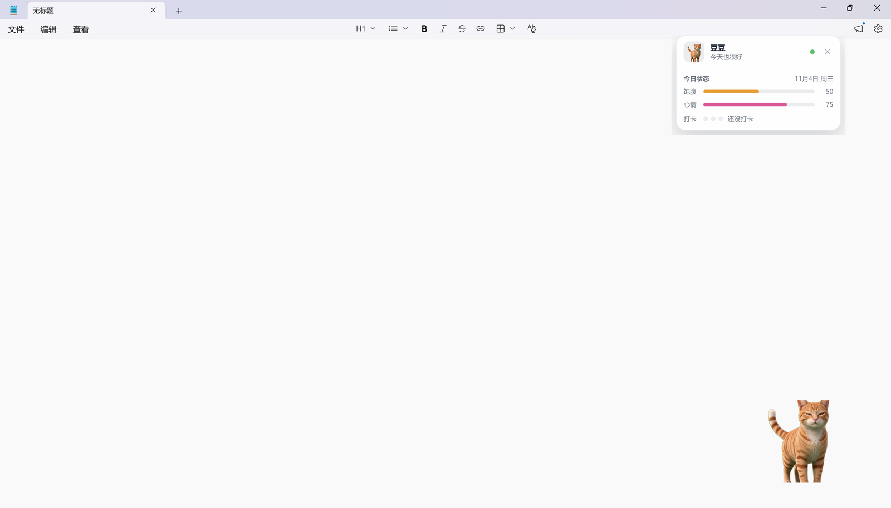
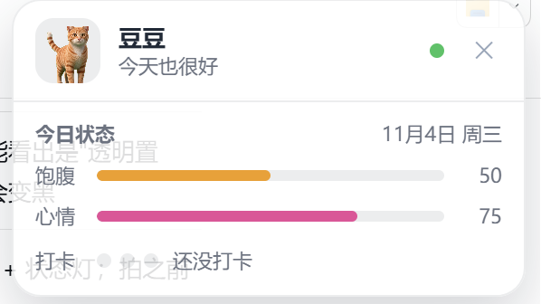
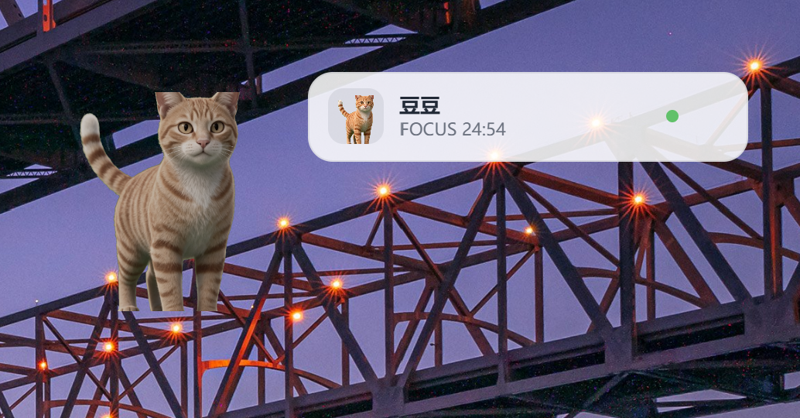
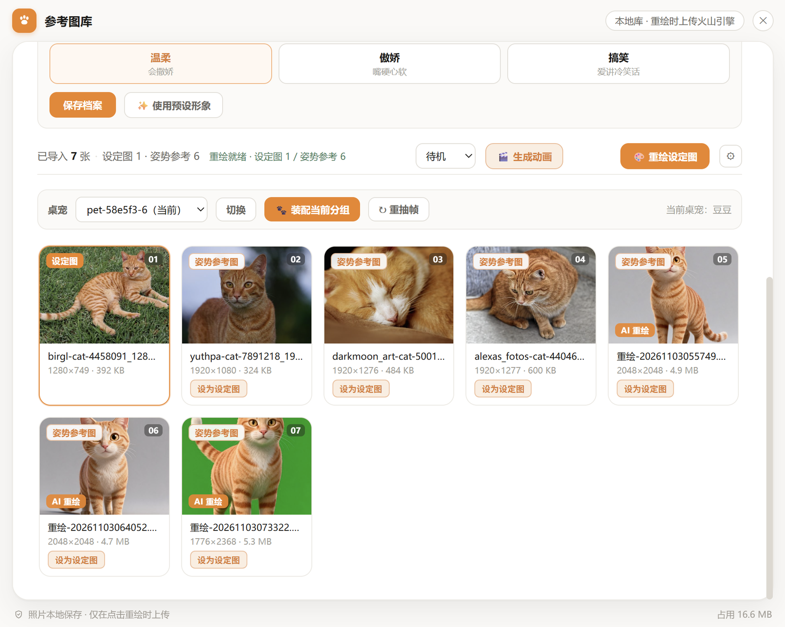
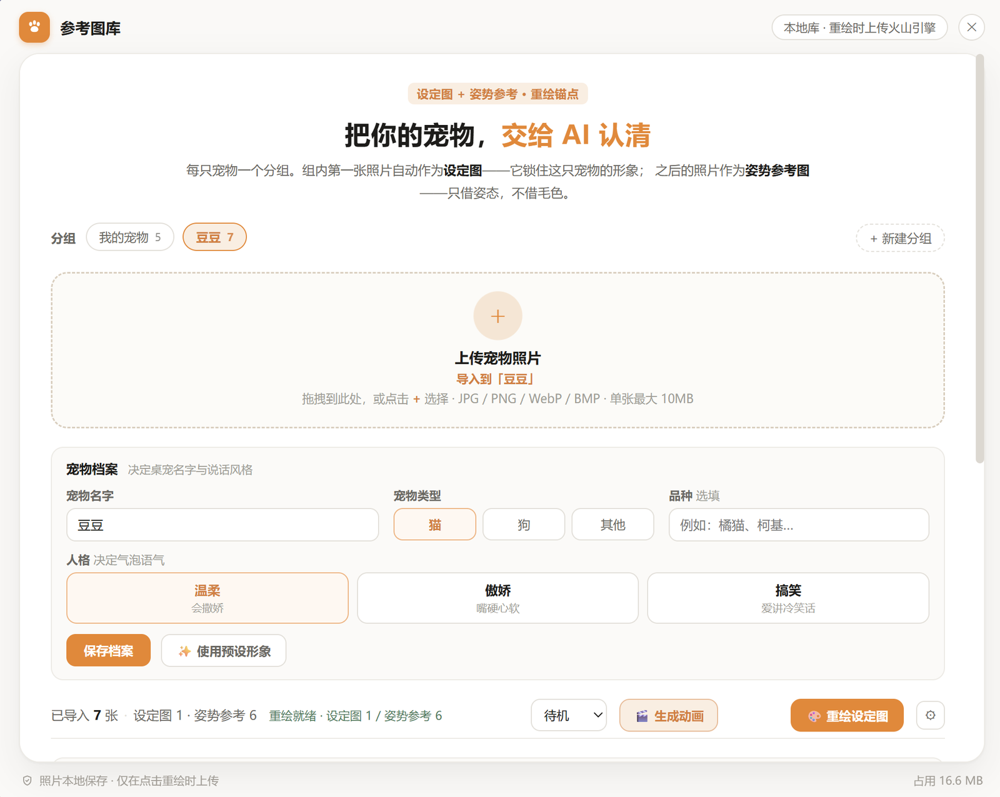
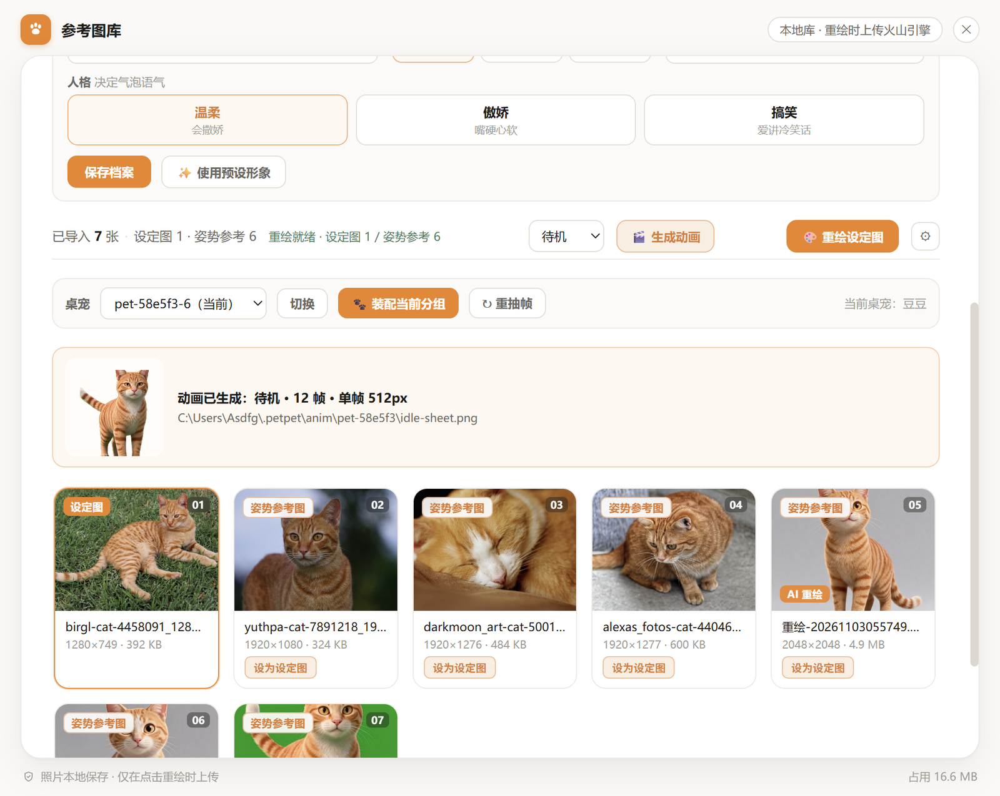
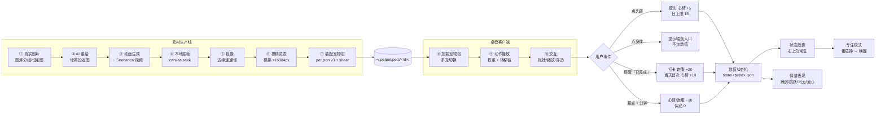
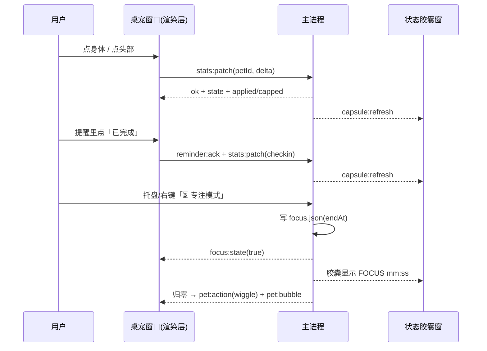

# PawPal · 从真实照片到会陪伴你的桌面宠物

[English](README.en.md) | **中文**


> **PawPal 不是一个"桌宠播放器"，而是一条从你家宠物照片到桌面替身的完整生产线**：
> 图库沉淀照片 → AI 重绘出风格化设定图 → AI 生成动作视频 → 本地抽帧抠像拼精灵表 → 一键装配成宠物包 → 桌面客户端加载运行。
> 它有自己的形象、动作、人格，还会提醒你喝水、陪你专注。

---

## 📸 界面一览

| 桌面宠物（透明置顶 + 右下角胶囊） | 状态胶囊（悬停展开） | 专注模式（FOCUS 倒计时，桌宠静止） |
|:---:|:---:|:---:|
|  |  |  |

| 参考图库（分组 / 缩略图 / 装配） | 宠物档案（类型与人格） | 动画生成（精灵表预览） |
|:---:|:---:|:---:|
|  |  |  |

> 截图来自 Windows 实机（豆豆，一只橘猫）。动画生成那张是本地「↻ 重抽帧」跑出来的真实预览（用已下载的 mp4 重新抽帧，不消耗云端额度）。
> 历史素材仍在 `assets/`：`demo-preview.jpg`（红苕桌宠实拍）、`demo.gif`（5 动作演示）。


## 先对齐预期

- **半自动，不是一键**：AI 生成是抽卡（同提示词出图不同），**主人核实不可替代**（AI 会认错宠物特征）。你决定它长什么样、做什么动作。
- **不提供现成素材**：本仓库给的是**生产线 + 参考客户端**，宠物形象请你用自己的照片跑出来。
- **只想要"照片动起来"**：用平台自带的"照片动起来"即可，不需要这套。

---

## 现在能做什么

### 素材生产（面板一键，或命令行）

| 能力 | 说明 |
|---|---|
| 参考图库 | 多宠分组、设定图/姿势参考两种角色、缩略图网格、拖拽与批量导入、单张 ≤10MB fail-closed |
| AI 重绘 | 把真实照片重绘成「四边绿幕」的风格化设定图（Seedream）；就绪度闸门（设定图 ≥1 且姿势参考 ≥3 才发请求） |
| 动画生成 | Seedance 出动作视频 → **本地**抽帧 + 边缘连通域抠像 + 横排拼表（不依赖 ffmpeg/Python）；任务 `taskId` 落盘可追溯，超时后仍可补下载再本地重抽 |
| 宠物包装配 | 产物 → `~/.petpet/pets/<id>/`（`pet.json` v3 + 精灵表），重名自动加序号，装完自动切换 |
| 契约校验 | `pipeline/validate_pet.py` 校验字段/纹理上限（`帧数 × 格宽 ≤ 16384px`）/自由文本净化 |

### 桌面客户端（`viewer/`，Electron + PixiJS）

| 能力 | 说明 |
|---|---|
| 多宠与动作 | 托盘/右键切换宠物；8+ 动作按权重随机 + `transitions` 行为转移链（手动切换不被自动打断） |
| 窗口交互 | 无边框透明置顶、拖拽移动、滚轮缩放（窗口跟随、夹回工作区）、**透明区鼠标穿透** |
| 提醒 | 面板/托盘建提醒（本地持久化）；到点**音效 + 抖动 + 头顶大气泡**，`[已完成]` 打卡，多条排队显示「还有 N 条」 |
| 左键分区 | 点**头部** = 摸头（心情 +5）；点**身体** = 提示喂食入口（**不加任何数值**） |
| 人格气泡 | `persona`（温柔/傲娇/搞笑）× 4 场景文案池，缺省回退 `bubbles` |
| 日记 | 从行为事件沉淀 `activity.json`，独立面板查看 |
| 状态数值 | 饱腹/心情/打卡：跨天重置、摸头日上限 15、**喂食只在提醒 `[已完成]` 里计一次**、漏点 1 分钟 −30 保底 0 |
| 情绪表现 | 饱腹 <30 瘫倒喊饿、>80 蹦 3 下；心情 <30 背对+乌云、>80 **爱心喷发 10 秒** |
| 状态胶囊 | 右上角常驻小窗：收起 56px 一条，悬停展开今日状态；透明区穿透、不抢焦点 |
| 专注模式 | 托盘/右键开设置卡（1–180 分钟）→ 胶囊走秒 → 桌宠变暗暂停随机 → 归零唤醒 |

### 工程与质量

| 项 | 现状 |
|---|---|
| 单测 | **303 例**（300 通过 / 3 skip）覆盖命中判定、数值状态机、提醒队列、专注计时、精灵表、图库存储、导入安全等 |
| CI | `素材管线测试`（3.9/3.11/3.12 三组）、`客户端构建`、`macOS 包`、`Windows 安装包` + Boundary Test |
| 回归脚本 | `viewer/scripts/boundary-test.cjs`（打断/转移边界）、`viewer/scripts/memtest.cjs`（100 次切换纹理平台期） |
| 安全 | 路径穿越白名单、zip slip 双向拦截、自由文本净化（零宽/BiDi）、密钥 `0600` 仅主进程持有 |

---

## 全景流程



**运行时调用关系**（谁调谁）：



---

## 快速开始

### 路径 A：面板一键（推荐，需要自备火山引擎密钥）

```bash
cd viewer
npm install
npm start
```

启动后：托盘/右键 →「🖼 参考图库」→ 建分组导入照片 →「🎨 重绘」出绿幕设定图 →「🎬 生成动画」出动作视频 →「📦 装配当前分组」→ 桌面立刻换成你的宠物。

> 不配置密钥则**完全不联网**，手工素材同样可以装配。

### 路径 B：命令行管线（不联网，Python）

```bash
pip install -r requirements.txt
python pipeline/select_frames.py --input <抽帧目录> --output selected/ --frames 12
python pipeline/remove_bg.py     --input selected/ --output cutout/
python pipeline/clean_cutout.py  --input cutout/   --output clean/
python pipeline/make_sheet.py    --input clean/    --output . --name mypet.png
python pipeline/validate_pet.py  mypet/            # 打包前必跑
```

### 路径 C：立刻看到效果（不开账号）

```bash
# macOS
mkdir -p ~/.petpet/pets && cp -r examples/dev-pet ~/.petpet/pets/dev-pet
# Windows：把 examples\dev-pet 复制到 C:\Users\<用户名>\.petpet\pets\dev-pet
```

安装版**首次启动自带一只示例宠物「豆豆」**（橘猫，待机 + 奔跑两个动作，随安装包分发、自动装到
`~/.petpet/pets/doudou-demo/`）；目录里已经有任何宠物包时**不会**再安装，绝不覆盖你的数据。

`examples/dev-pet` 是 **8 动作自测包**（0.5MB、256px、全透明底），专门用来验证交互/数值/提醒/专注——**不是正式美术素材**。

### 跑测试

```bash
cd viewer && npm test          # vitest 303 例
python -m pytest tests/        # 管线单测
python pipeline/check_refs.py  # 文档矩阵引用完整性
```

---

## 仓库结构

```
PawPal/
├── README.md / README.en.md   中文（本文）/ 英文
├── docs/                      方法论文档 00–16 + 审查清单 + 安全清单 + handoff 交付书
├── pipeline/                  可运行脚本（选帧/抠图/清理/拼表/校验/提示词/文档检查）
├── schema/                    机器可读契约（pet.json v3 + 宠物画像 16 字段）
├── templates/                 填空模板（pet-profile.example.json）
├── viewer/                    客户端参考实现（Electron + PixiJS + 素材生产面板）
│   ├── main.js                主进程：窗口/托盘/菜单/提醒/动画任务/装配
│   ├── companion.cjs          数值门面（stats / prefs / persona 回写）
│   ├── stats-store.cjs        数值状态机（跨天重置 / 每日上限 / 惩罚 / 原子写）
│   ├── status-focus.cjs       状态胶囊窗
│   ├── focus.cjs / focus-time.cjs
│   ├── capsule.* / focus.*    胶囊与专注设置卡 UI
│   ├── refs.* / pet-assembler.cjs / animator*   图库 / 装配 / 动画（本轮冻结）
│   ├── scripts/               boundary-test / memtest / 端到端脚本
│   └── src/                   桌宠渲染层（PIXI + 命中判定 + 表现层）
├── examples/                  示例宠物包（dev-pet 自测 / redshao 闭环 / baobao 第二样本 / demo 包）
├── tests/                     管线 pytest
├── assets/                    历史展示素材（demo-preview.jpg / demo.gif）
└── SECURITY.md / CONTRIBUTING.md / LICENSE
```

---

## 数据契约（`pet.json` v3）

顶层 12 字段：`version / id / name / style / theme / cellWidth / cellHeight / bubbles / identity / temperament / persona / actions`

| 字段 | 作用 |
|---|---|
| `persona` | 人格：`温柔` / `傲娇` / `搞笑`——决定气泡文案池（缺失回退 `bubbles`） |
| `identity` / `temperament` | V2-A：身份事实 + 气质滑杆（0–1 对象），调制随机行为权重 |
| `actions` | 每个动作：`file/sprite`、`frames`、`fps`、`weight`、`label`、`diary`、`transitions`、`scale`、`loop`、`pingpong` |
| 纹理红线 | **`frames × cellWidth ≤ 16384px`**（WebGL 单轴上限，超了整窗黑屏） |

完整契约见 [docs/08-接口协议.md](docs/08-接口协议.md)，能力实现状态见 [docs/14-实现状态矩阵.md](docs/14-实现状态矩阵.md)。

---

## 文档导航

| 你想做什么 | 看什么 |
|---|---|
| 给自己的宠物做桌宠 | [01-数据模型](docs/01-数据模型.md) → [02-提示词](docs/02-特征与提示词.md) → [05-素材管线](docs/05-素材管线.md) |
| 了解设计与取舍 | [00-设计缘起](docs/00-设计缘起.md) → [04-架构设计](docs/04-架构设计.md) → [10-架构升级评估](docs/10-架构升级评估.md) |
| 查实现状态 | **[14-实现状态矩阵](docs/14-实现状态矩阵.md)**（唯一事实源）→ [13-验证台账](docs/13-验证台账-20260810.md) |
| 避坑 | [07-踩坑实录](docs/07-踩坑实录.md)（11 条真实事故与铁律） |
| 动画链路细节 | [16-桌宠动画链路](docs/16-桌宠动画链路-20261103.md) |
| 分工与共享契约 | [docs/handoff/README.md](docs/handoff/README.md)（C1–C5 契约、依赖矩阵） |

---

## 核心思想（一句话版）

1. **宠物即数据包**：换宠物 = 换目录，不动代码
2. **提示词是特征的翻译**：结构化特征 → 可控生成
3. **每步工具可替换**：Seedance / rembg / PIL 都不是唯一解
4. **淘气有边界**：视觉上的淘气可以，真实文件操作不做
5. **诚实标注状态**：没实测过的功能不宣称已支持

---

## Roadmap

**✅ 已完成**：素材生产线（图库 / 重绘 / 动画 / 装配 / 校验）· 桌面客户端（多宠、动作转移、提醒三件套、日记、人格气泡、命中判定）· 状态数值与情绪表现 · 状态胶囊 + 专注模式 · CI/Release 自动化 · 303 单测

**🔨 进行中**：Windows 真机手测闭环 · 手势与交互细化 · 文档与截图补齐

**🔭 规划中**：记忆与关系系统（事件 → 习惯）· 展示与分享 · 主题包

---

## 贡献

- 新宠物实例：按 [08-接口协议](docs/08-接口协议.md) 提交宠物包
- 新踩坑：在 [07-踩坑实录](docs/07-踩坑实录.md) 追加
- 代码：`npm test` 与 `python pipeline/check_refs.py` 必须绿；提交信息不含具体 AI 工具名

---

## License

- **代码**（`pipeline/`、`viewer/`）：[MIT](LICENSE)
- **素材**（`examples/`、`assets/`）：版权归宠物主人所有，仅作示例，请勿商用或二次分发
- **AI 生成素材**：发布时请保留平台标识要求（详见 [02-特征与提示词](docs/02-特征与提示词.md)）
